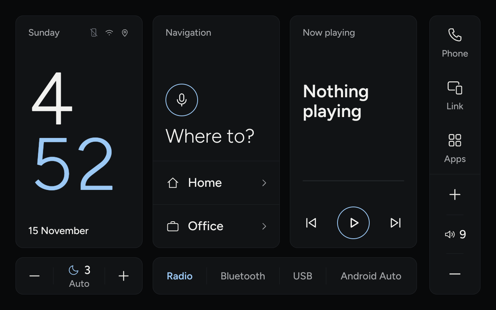

# Cabin

A calm, distraction-free launcher for an Android car stereo, built to be glanced at, not browsed.



## Why

Driving is the one time you can't give a screen your attention. The display in the dash is read in half-second glances, with the road still your real job, so its only duty is to hand you what you need and then get out of the way.

The launcher that shipped on my head unit did the opposite. It was a phone home screen dropped into a car: loud colours, busy tiles, built for browsing. But in a car you aren't browsing. You want the same few things every time, exactly where you left them (where am I going, what's playing, what time is it, am I connected), without hunting or aiming for them.

Cabin is that home screen. One accent colour, large legible type, targets big enough to hit without looking, and nothing that moves or animates to pull your eye. Calm, minimal and predictable, so your attention stays on the road.

## What it is

Cabin is a home-screen replacement (launcher) for Android head units. The look is called **Slate**: flat, dark and still.

It is built for a right-hand-drive car, so the primary controls sit on the right, nearest the driver, and it is configurable for left-hand drive as well. The layout is drawn on a 1280×800 canvas and scaled to fit, so other landscape head units of a similar shape should work too.

Written in **Kotlin** with **Jetpack Compose**, with no third-party UI libraries.

## On the home screen

Everything useful at a glance, each thing always in the same place:

- **Time and date**, large enough to read from the driver's seat.
- **Navigation**: "Where to?", one-tap Home and Office, and the next turn and arrival time while Google Maps is navigating.
- **Now playing**: title, artist, cover and transport controls for whatever app is playing.
- **Sources**: Radio, Bluetooth, USB and Android Auto, one tap each.
- **Connection status**: phone, Wi-Fi and GPS.
- **Brightness and night mode**, with an Auto setting that follows day and night.
- **Side rail**: phone, phone link, all apps and volume, on the edge nearest the driver.

## More

- **All apps**: a plain grid, alphabetical until you arrange it. No brand logos: each app is a simple line icon or its initial.
- **Side bar over other apps**: Back, Home (hold it for recent apps), volume and split screen stay within reach on top of any app. The bar tucks itself away after a time you choose (immediately, 5 seconds, 10 seconds or never), and a small handle brings it back.
- **Split screen**: hold an app, pick a second, and they open side by side.
- **Gestures**: swipe sideways between Home and apps, swipe down for notifications, drag two fingers for volume. Each can be changed or switched off.
- **Steering wheel keys**: volume, mute, next, previous, play/pause, search and mode are handled.
- **Themes**: ten, with one accent colour each. Blue is the default.
- **Layout**: put the side rail on either edge, reorder the three home panels, set the tuck-away time, or reset it all.
- **Screen off**: a black screen for night driving. A tap wakes it.
- **Private**: Cabin has no internet permission and sends nothing anywhere.

More screens are in [`docs/screenshots`](docs/screenshots).

## Size and memory

Measured on version 0.1.0, release build, on a 1280×800 Android 13 emulator with 4 GB of RAM. These are emulator figures; they have not been checked on the head unit yet.

| What | Figure |
|---|---|
| APK size | ≈ 2.2 MB (2,205,326 bytes) |
| Installed size | ≈ 10.3 MB, after a full ahead-of-time compile (the largest case) |
| Memory | ≈ 37,124 KiB PSS (38.0 MB), Home showing, nothing playing |
| Memory after restart | ≈ 61,477 KiB PSS (63.0 MB), sixteen seconds after the process restarted |
| Start, first after boot | ≈ 1.4 s (1,371 ms) to the first frame |
| Threads from the app | 5: the main thread, and 4 background workers that read the app list, settings and media details off the main thread and sleep when there is nothing to do |
| Processes and activities | One process, two activities (the second is the split chooser) |
| Internet permission | None, no network activity or telemetry |

## Design rules

The constraints that keep it glanceable:

- Sized for a moving car: touch targets about 96 px and up, text 24 px and up, on the 1280×800 canvas.
- Dark and flat, with no blur and no animation.
- One accent colour at a time.
- No third-party logos.
- Primary controls on the driver's side.
- Fast and light on memory.

## Status

A personal project, sideloaded, with no Play Store release. It is a work in progress.

It has been built and tested on a 1280×800 Android 13 emulator. Testing on the real head unit has only just begun, so anything that depends on the unit's own firmware (its radio and Bluetooth apps, steering wheel keys, headlight dimming, split screen) is not confirmed there yet.

Cabin needs Android 10 or later (minSdk 29, targetSdk 33). Split screen needs Android 12L or later.

## Build and install

```bash
./gradlew :app:assembleRelease
# output: app/build/outputs/apk/release/app-release.apk
```

Install it with `adb install -r`, or copy the APK to a USB stick and open it from the unit's file manager.

Cabin opens on a Setup screen the first time it runs. From there you make Cabin the home app and grant what it asks for: notification access (Now playing and Navigation), brightness control, and the side bar over other apps. Each one is optional. Without it, the feature it serves is simply off.

## License

[GNU General Public License v3.0](LICENSE)
